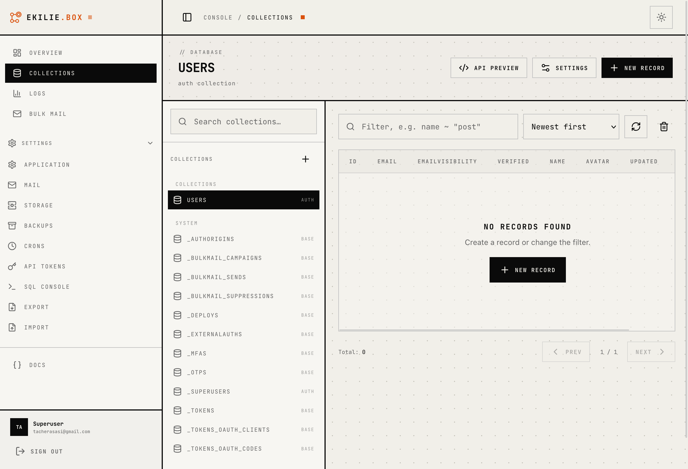

# Ekilie Box

### The backend-in-a-box

**One file. One command. A complete backend and admin console.**

Ekilie Box gives you a database, user accounts, file storage, realtime updates, email, scheduled jobs, backups and a
polished admin console, all in a single portable binary. No database server, no containers, no cloud account, no
separate frontend to deploy.

Download it, start it, and you have somewhere to build.

<p align="center">
  
</p>

## Why Ekilie Box

- **One binary.** The app, database, API and console ship together. Nothing else to install or wire up.
- **Complete from day one.** Store data, manage accounts, upload files, push realtime updates, send email, run
  scheduled jobs and take backups without stitching together services.
- **A console you will actually enjoy.** Create collections, edit records, browse files, inspect logs and change
  settings visually. No SQL required, but it is there when you want it.
- **Private by design.** New collections start locked to your owner account. You decide what is public.
- **Portable.** Your database and uploads live in one data folder. Move it, back it up, or run it from a USB drive.
- **Yours.** Self-hosted, MIT licensed, no SaaS lock-in and no telemetry.
- **API-first.** Every screen in the console uses the same clean REST and realtime APIs your apps can call.

Made for side projects, internal tools, prototypes, mobile app backends and small products that need a real backend
without a platform bill.

## Quick start

### 1. Get the binary

Download the release for your platform from
[github.com/ekilie/box/releases](https://github.com/ekilie/box/releases), or build it from source:

```bash
git clone https://github.com/ekilie/box.git
cd box
make build
```

### 2. Create your owner account

There is no public signup. The first account owns the instance.

```bash
./ekilie-box superuser upsert you@example.com 'a-strong-password'
```

### 3. Start Ekilie Box

```bash
./ekilie-box serve
```

Open **http://127.0.0.1:8090/** and sign in.

```
Console:  http://127.0.0.1:8090/
API:      http://127.0.0.1:8090/api/
```

That is the whole setup. Your data and uploads are created in `ekilie_box_data` beside the binary.

## Your first five minutes

1. **Create a collection:** think of it as a table. In the console, open **Collections**, choose **New collection**
   and add fields such as `title`, `body`, `published` or `cover`.
2. **Add a record:** open the collection and create your first row. File fields accept uploads right in the console.
3. **Try the API:** open **API explorer** to send requests against your new collection and copy the exact call for
   your app.
4. **Invite your app:** use the REST API from any language, or connect a web or mobile client to the realtime feed.
5. **Make it yours:** change the app name, colours, mail settings and backups under **Settings**.

## What is inside

### Console

- Dashboard with instance health, database size, collections, users, backups, cron jobs and recent errors.
- Collection and record management with filters, sorting, pagination, relations, inline create, JSON validation and file uploads.
- Collection editor with schema diffs, full field options, OAuth2 providers, index suggestions and view-query preview.
- URL-addressable record editor, so you can link directly to a row.
- Command palette (`Cmd/Ctrl+K`), collapsible icon sidebar (`Cmd/Ctrl+B`), light and dark themes.
- Logs with saved filters, request detail, volume charts and a live tail.
- Storage usage, file replace/delete, import diffs and backup schedule controls.
- API explorer, generated API docs, schema relation graph and realtime inspector.
- Observability, status, audit, auth and migration views.
- SQL console with schema browsing, saved queries and CSV export.
- Application, mail, storage, backup, cron, token, import and export settings.
- Crons: create and run scheduled HTTP requests, and trigger jobs registered in code.
- Bulk email campaigns and suppression management.
- Security advisories, runtime information and migration history.

### Platform

- Embedded SQLite database with automatic migrations.
- Email/password accounts, one-time passwords, MFA and OAuth2 providers.
- File storage on disk or S3-compatible storage, with protected file fields.
- REST API, realtime subscriptions, API tokens and request logs.
- Scheduled jobs, email delivery, backups, point-in-time restore and vacuum.
- Extensible with JavaScript hooks, custom pages and MCP.

## Requirements

**To run:** a prebuilt binary needs nothing else. Supported platforms are published on the
[releases page](https://github.com/ekilie/box/releases).

**To build from source:**

- Go 1.27+
- Bun 1.4+ (only for the console)
- No external database or services

## Configuration

Ekilie Box reads `ekiliebox.yaml` (or `--config <path>`) and a `.env` file beside it. Command-line flags win over
config values.

```yaml
app:
  dir: ekilie_box_data
  hooks_dir: ekilie_box_hooks
  migrations_dir: ekilie_box_migrations

server:
  http: 127.0.0.1:8090

vacuum:
  enabled: true
  every: 168h

pitr:
  enabled: true
  retention: 72h
```

See every setting the binary understands:

```bash
./ekilie-box config
./ekilie-box config --json
```

## Commands

```bash
./ekilie-box serve              # start Ekilie Box
./ekilie-box info               # version, paths and console URL
./ekilie-box info --json
./ekilie-box superuser upsert you@example.com 'a-strong-password'
./ekilie-box migrate            # run pending migrations
./ekilie-box upgrade            # replace with the latest release, keeping the old binary
```

Advanced workflows are available too: `remote`, `deploy`, `dev`, `pull`, `logs`, `token`, `oauth`, `pages` and
`pitr`. Run `./ekilie-box --help` for the full list.

`upgrade` expects release archives named `ekilie-box_<version>_<os>_<arch>.zip`, which is what
`.goreleaser.yaml` produces.

## API

Everything the console does is available over HTTP. Use it from a web app, mobile app, script or another service.

```bash
curl http://127.0.0.1:8090/api/health
```

- `GET /api/health`: public health check. `X-Powered-By` reports the Ekilie Box version.
- `GET /api/...`: records, authentication, files, realtime, settings and operational APIs.
- `GET /`: the console.

Sign in with your owner account to get an API token, then send it as `Authorization: <token>`. The console's **API
explorer** shows working requests for every endpoint, with copy-ready cURL.

## Security

- New collections are locked to the owner account. Open access deliberately with API rules.
- The owner account bypasses collection rules, so the console always works while anonymous requests are denied.
- Mark file fields as **Protected** to require signed access. Otherwise uploaded files are served publicly.
- Use HTTPS and a reverse proxy when exposing Ekilie Box to the internet.
- Keep `ekiliebox.yaml`, `.env` and the data folder out of version control.

## Development

```bash
# Build the console into internal/ui/dist, then the binary
make build

# Build the console once, then run without rebuilding it
make ui
go run -tags no_ui ./cmd/box serve

# Console hot reload (Vite proxies /api to the Go process on :8090)
make dev-ui
go run -tags no_ui ./cmd/box serve
```

The console's production build is generated into `internal/ui/dist` and embedded in the binary. `make build` builds
it automatically; release archives include it. Run `make ui` before a plain `go build`. `CGO_ENABLED=0` uses the
pure-Go SQLite driver, producing a single statically linked executable.

```bash
make test     # Go tests
make tidy     # tidy modules
make clean    # remove build output
make release  # build release archives
```

### Project layout

```
.
├── cmd/
│   └── box/
│       └── main.go              entry point
├── internal/
│   ├── app/                     bootstrap, config and static serving
│   ├── commands/                info, upgrade and other commands
│   ├── extensions/              vacuum and development mail
│   └── ui/                      embedded console assets
│       └── dist/                built console (generated, gitignored)
├── web/                         React + TanStack Router + Tailwind console
│   ├── src/
│   │   ├── components/
│   │   ├── pages/
│   │   ├── lib/
│   │   └── router.tsx
│   ├── public/
│   └── package.json
├── ekiliebox.yaml               example config
├── .env.example
├── .goreleaser.yaml
├── Makefile
├── go.mod
└── go.sum
```

The Go process serves:

```
GET /             -> embedded console (SPA fallback for client routes)
GET /assets/...   -> console assets
GET /api/...      -> REST, realtime and settings APIs
```

`--publicDir` can override the embedded console with a directory on disk, which is useful when debugging a Vite
build.

## Control plane

Ekilie Box is deliberately a single-app product. The separate control-plane design for multiple instances, deploys, domains, secrets and teams lives in [docs/control-plane.md](docs/control-plane.md).

## License

MIT © 2026 Ekilie. See [LICENSE](LICENSE).

Built by [Ekilie](https://github.com/ekilie).
